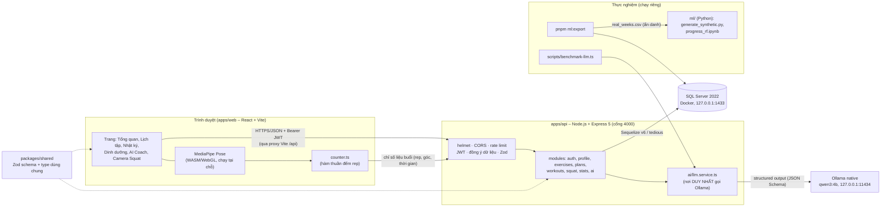
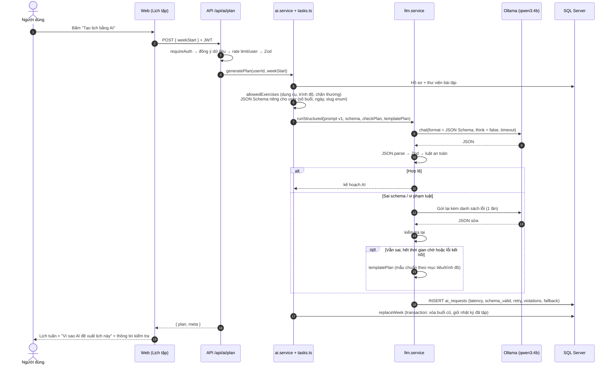
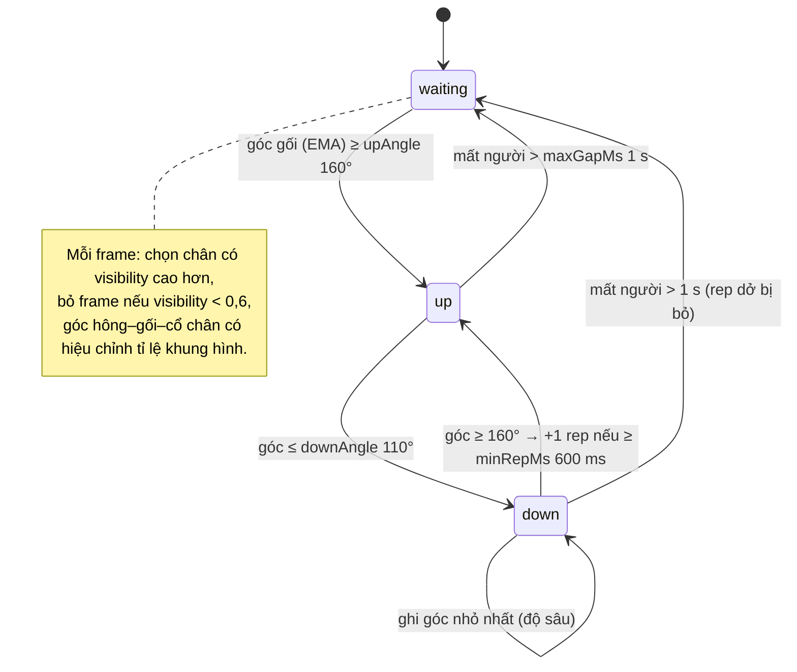

# Kiến trúc hệ thống – AI Coach Gym

Các sơ đồ viết bằng Mermaid: GitHub và VS Code (extension *Markdown Preview Mermaid Support*) hiển thị trực tiếp; muốn xuất ảnh cho báo cáo thì dán từng khối vào <https://mermaid.live>.

## 1. Tổng quan thành phần

Mọi thứ chạy trên **một máy** (Windows 11, GPU 12 GB). Trình duyệt chỉ nói chuyện với API; LLM và camera không bao giờ đi qua mạng ngoài (riêng file mô hình MediaPipe được tải một lần từ CDN).



| Thư mục | Vai trò |
|---|---|
| `apps/web/src/features/<tính năng>` | Trang và hook TanStack Query; `squat/` có bộ đếm thuần và chế độ đánh giá video |
| `apps/api/src/modules/<module>` | `routes` (đường dẫn + validate), `controller` (HTTP), `service` (nghiệp vụ), `model` (Sequelize) |
| `apps/api/src/modules/ai` | `llm.service` (gọi Ollama, retry, fallback, log), `tasks` (prompt + schema + luật cho từng tác vụ), `safety-rules`, `templates`, `prompts/*.v1.ts` |
| `apps/api/src/db` | migrations, seeders (40 bài tập), `seed-library` |
| `apps/api/src/scripts` | `export-training` (dữ liệu ML), `seed-demo` (tài khoản demo) |
| `packages/shared` | Một nguồn duy nhất cho schema request/response, hằng số, hàm tính (khối lượng, ngày tuần…) |

## 2. Luồng AI sinh kế hoạch tuần



Dinh dưỡng (`/api/ai/nutrition`) đi cùng đường ống, với `referenceTargets` (Mifflin–St Jeor) làm tham chiếu và `checkNutrition` (calo tối thiểu theo giới tính, protein 1,2–2,4 g/kg, macro khớp calo). Nhận xét tuần (`/api/ai/review`) cho hệ thống tự tính số liệu, AI chỉ diễn giải. Chat (`/api/ai/chat`) cũng dùng JSON Schema để tắt được chế độ "thinking".

## 3. Bộ đếm Squat (máy trạng thái)



Khoảng cách giữa 110° và 160° là **ngưỡng trễ (hysteresis)**: rung lắc quanh một ngưỡng không tạo rep giả. Mọi ngưỡng nằm trong `apps/web/src/features/squat/config.ts`.

## 4. Cơ sở dữ liệu

```mermaid
erDiagram
  users ||--o| profiles : "có"
  users ||--o{ plans : "1 kế hoạch / tuần"
  plans ||--o{ plan_sessions : "buổi theo ngày"
  plan_sessions ||--o{ plan_session_exercises : "bài, set, rep"
  exercises ||--o{ plan_session_exercises : ""
  users ||--o{ workout_logs : "nhật ký"
  workout_logs ||--o{ workout_sets : "từng set"
  exercises ||--o{ workout_sets : ""
  plan_sessions |o--o{ workout_logs : "session_id (null khi xóa buổi)"
  users ||--o{ weight_logs : "1 lần cân / ngày"
  users ||--o{ squat_sessions : "kết quả camera"
  users ||--o{ nutrition_days : "1 thực đơn / ngày"
  users ||--o{ ai_requests : "log thực nghiệm"

  users { int id PK; nvarchar email UK; nvarchar password_hash; datetimeoffset health_consent_at; bit consent_camera; bit consent_research }
  profiles { int user_id FK; nvarchar goal; int age; decimal weight_kg; nvarchar injuries; int sessions_per_week }
  plans { int id PK; int user_id FK; date week_start; nvarchar source; nvarchar ai_note }
  workout_logs { int id PK; int user_id FK; int session_id FK; datetimeoffset started_at; nvarchar feeling }
  ai_requests { int id PK; int user_id FK; nvarchar task; nvarchar model; nvarchar prompt_version; int latency_ms; bit schema_valid; int retry_count; nvarchar violations; bit used_fallback }
  squat_sessions { int id PK; int user_id FK; int rep_count; decimal avg_min_knee_angle; nvarchar model; decimal avg_fps }
```

- Schema chỉ thay đổi qua **migration** (`apps/api/src/db/migrations`), không dùng `sync({ alter: true })`. Chuỗi tiếng Việt dùng NVARCHAR.
- SQL Server cấm nhiều đường cascade, nên chỉ chuỗi sở hữu `users → …` là `ON DELETE CASCADE`. Liên kết tới `exercises` và `workout_logs.session_id` là NO ACTION và được xử lý trong code (xóa buổi thì đặt `session_id` về null để giữ lịch sử).
- Không lưu video, ảnh hay landmark. Bảng `squat_sessions` chỉ có số liệu tổng hợp.

## 5. Kiểm thử

| Lớp | Ở đâu | Chạy |
|---|---|---|
| Hàm thuần (đếm rep, luật an toàn, mẫu chuẩn, tổng hợp thống kê, CSV) | `*.test.ts` trong web/api/shared | `pnpm test` |
| HTTP (định tuyến, validate, phân quyền, bảo mật) | `apps/api/src/**/*routes*.test.ts`, `security.test.ts` (service giả) | `pnpm test` |
| Tích hợp SQL Server (transaction, cascade, quyền sở hữu, AI pipeline với model giả) | `apps/api/src/integration.db.test.ts`, DB riêng `ai_coach_test` | `pnpm test` (tự bỏ qua nếu chưa `pnpm db:up`; CI luôn chạy) |
| Thực nghiệm | `scripts/benchmark-llm.ts`, `ml/`, chế độ đánh giá video | xem [experiments.md](experiments.md) |

Bảo mật: xem [security.md](security.md). Kịch bản trình diễn: xem [demo.md](demo.md).
